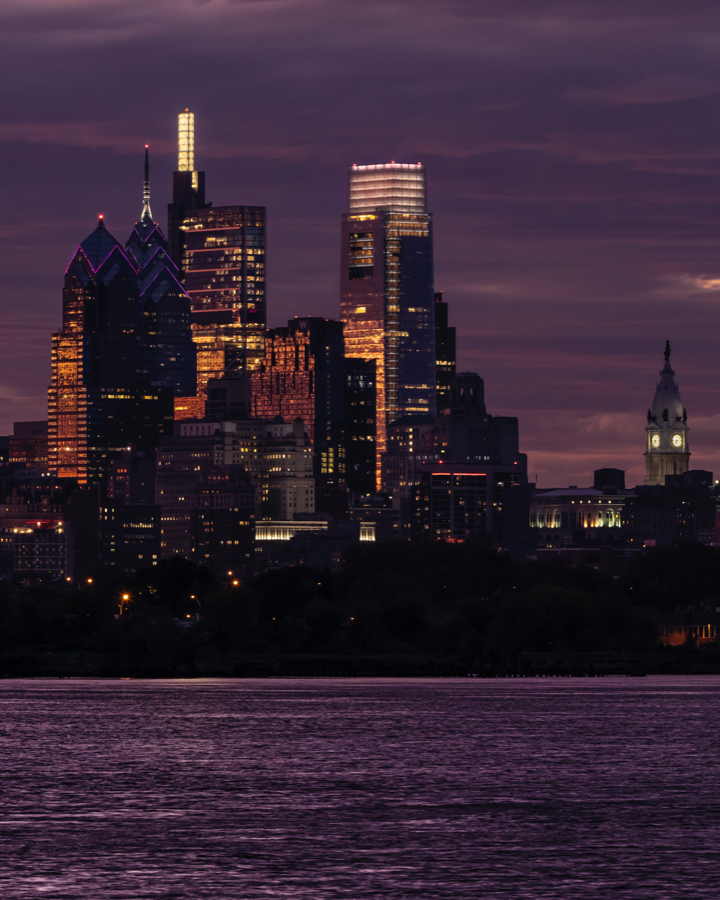
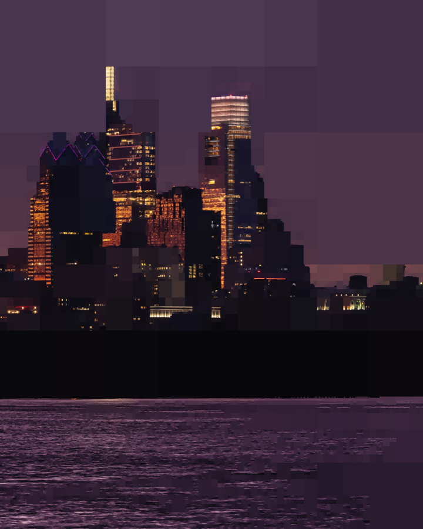

# Image Processor

Консольная программа на C++23 для применения фильтров к изображениям BMP. Поддерживаются несжатые 24-битные BMP-файлы.

## Сборка

Нужны CMake 3.20 или новее и компилятор с поддержкой C++23.

```bash
cmake -S . -B build
cmake --build build --parallel
```

Чтобы запустить тесты:

```bash
ctest --test-dir build --output-on-failure
```

## Запуск

```text
./build/image_processor <входной.bmp> <выходной.bmp> [фильтр ...]
```

Фильтры можно комбинировать: программа применяет их к изображению в указанном порядке.

| Параметр | Действие |
| --- | --- |
| `-crop <ширина> <высота>` | Обрезать изображение до заданных размеров |
| `-gs` | Преобразовать изображение в оттенки серого |
| `-neg` | Инвертировать цвета |
| `-sharp` | Повысить резкость |
| `-edge <порог>` | Выделить границы с заданным порогом |
| `-blur <сигма>` | Применить размытие Гаусса |
| `-quad <порог>` | Применить мозаичный фильтр на основе квадродерева |

Запуск без аргументов выводит краткую справку:

```bash
./build/image_processor
```

## Примеры

Преобразовать тестовое изображение в оттенки серого:

```bash
./build/image_processor tests/input/philly.bmp /tmp/philly-gray.bmp -gs
```

Применить негатив, а затем размытие Гаусса:

```bash
./build/image_processor tests/input/philly.bmp /tmp/philly-negative-blur.bmp -neg -blur 1.0
```

Квадродерево делит изображение на области: однородные области закрашиваются их средним цветом, а неоднородные рекурсивно делятся на четыре части. Порог — неотрицательное значение дисперсии цвета; чем он выше, тем крупнее могут быть области мозаики.

Применить фильтр к тестовому изображению Филадельфии:

```bash
./build/image_processor tests/input/philly.bmp /tmp/philly-quadtree.bmp -quad 0.005
```

Значение `0.005` также используется в тестовом скрипте проекта. Ниже — уменьшенные превью исходника и результата, созданного этой командой:

| Исходное изображение | После `-quad 0.005` |
| --- | --- |
|  |  |
